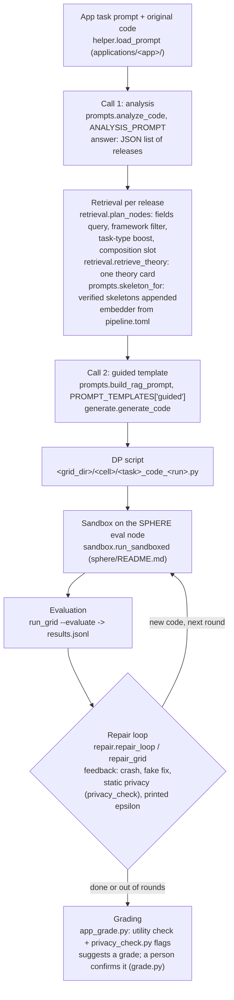

# Architecture

This page shows how one generation moves through the pipeline, and which module does each step. The method and
the reasons behind each step are in [method.md](method.md). The grading rules are in
[grading_rubric.md](grading_rubric.md).

Every setting that shapes a generation (embedder, K, query mode, filter, template, theory card, skeletons,
holdout, think flag, models, conditions, token limits, timeouts) is in `pipeline.toml` at the repo root.
`run_grid` saves the resolved settings, with the corpus and theory hashes, the lock-file hash and the git commit,
in `<grid_dir>/pipeline_frozen.json`. It refuses to add to a grid whose frozen settings differ.

## The steps

1. **Task prompt.** `helper.load_prompt` reads `applications/<app>/prompt.txt` and puts the original code in
   place of `{code}`. It sets the framework line, or removes it when no framework is named.
2. **Call 1: analysis.** `prompts.analyze_code` asks the same model to list every value the code releases, as
   JSON. Each release has a query type, a definition, columns, row filters and one or two task types. If the
   answer has no JSON list, the whole prompt is used as a single release (`retrieval.fallback_release`).
3. **Retrieval.** `retrieval.plan_nodes` runs one `fields` query per release, with the framework filter. Among the
   dense top 10, outlines whose task type matches the release move to the front. The per-release results are
   merged, best first. With two or more releases, one extra slot holds a pure-DP budget-splitting outline.
   `retrieval.retrieve_theory` adds one theory card. With skeletons on, `prompts.skeleton_for` appends the
   verified code skeleton of each outline. Indexes are built and loaded by `retrieval.load_index`.
4. **Call 2: generation.** `prompts.build_rag_prompt` puts the analysis, the theory card and the outlines into the
   guided template. `generate.generate_code` sends it and saves the first code block.
5. **Sandbox.** `sandbox.run_sandboxed` runs each script in a fresh scratch folder, with a copy of the data, a
   timeout and an allowlisted environment. Generated code never runs on the XDC. On the SPHERE eval node it runs
   as a separate user with no network (`sphere/README.md`).
6. **Evaluation.** `run_grid --evaluate` runs every script and writes `results.jsonl`.
7. **Repair.** `repair.repair_grid` (on a finished, evaluated grid, on the eval node, 2 rounds; `pipeline.toml`
   has `repair = 0`, so generation on the XDC runs no code) or `repair.repair_loop` (inline with `--repair N`)
   sends one kind of feedback per round: the crash, a fake fix, a static privacy flaw from `privacy_check`, or a
   printed epsilon that is missing or over budget. Every round is kept.
8. **Grading.** `app_grade` compares the DP results with the original analysis and adds the `privacy_check`
   flags. It suggests a grade. A person confirms every grade by hand (`grade.py`, `docs/grading_rubric.md`).

The toy grid tasks (`prompts/*.txt`) skip call 1: they already have a `Query type:` line, so retrieval runs one
query for the whole task.

## Modules

| Module | Role |
|---|---|
| `helper.py` | paths, `pipeline.toml` loader, model clients, prompt loading, code extraction |
| `retrieval.py` | corpus loading, index build/load, corpus hash, queries, search, boost, plan, theory card |
| `prompts.py` | templates, task types, the analysis call, skeletons, the final RAG prompt |
| `rag.py` | command line for `build`, `eval`, `theory-eval`, `app-eval`, `analyze-apps` |
| `rag_eval.py` | the offline retrieval metrics behind those commands |
| `generate.py` | one generation (calls 1 and 2, optional repair) |
| `run_grid.py` | the grid: freezes the pipeline, runs generations, runs the evaluation |
| `sandbox.py` | how every script is run |
| `repair.py` | the repair loop |
| `privacy_check.py` | static privacy rules |
| `app_grade.py`, `grade.py` | grading helpers; grades are given by hand |
| `check_corpus.py` | corpus checks (format, API names, leak words, skeleton tests) |
| `verify_env.py` | compares the installed packages with the lock |
